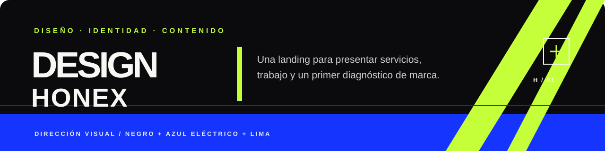
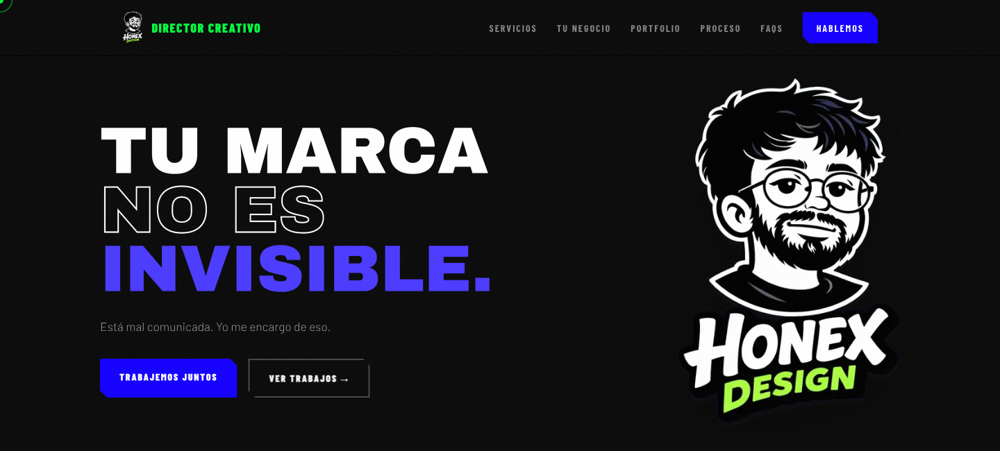
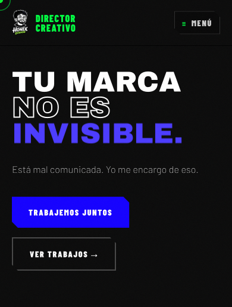
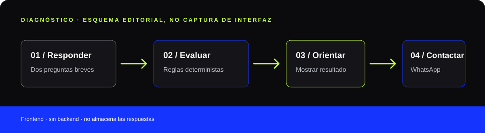

<p align="center"></p>

# Design Honex

Landing de diseño gráfico, branding y contenido para redes. Presenta servicios y trabajos, y propone un diagnóstico breve que ayuda a iniciar una consulta con contexto.

<p>
  <a href="https://design-honex.vercel.app">Sitio en producción</a> ·
  <a href="https://github.com/MaxiPerlo15/design-honex/wiki">Wiki del proyecto</a> ·
  <a href="#guia-tecnica">Guía técnica</a>
</p>

<p>
  
  
  
  
</p>

<a id="recorrido"></a>
## Recorrido

- [Qué resuelve](#que-resuelve)
- [El sitio en escritorio y móvil](#experiencia-en-produccion)
- [Capacidades](#capacidades)
- [Stack y decisiones](#stack-y-decisiones)
- [Documentación](#documentacion)
- [Guía técnica](#guia-tecnica)

<a id="que-resuelve"></a>
## Qué resuelve

Una presencia comercial clara para explicar servicios, mostrar trabajos y acercar el primer contacto. El diagnóstico usa reglas deterministas en el frontend: no es IA, no necesita backend y no guarda respuestas en una base de datos.

<a id="experiencia-en-produccion"></a>
## El sitio en escritorio y móvil

| Escritorio · 1440 px | Móvil · 390 px |
| --- | --- |
|  |  |

<a id="capacidades"></a>
## Capacidades

- **Diagnóstico de negocio:** recorrido breve con resultado, reinicio y enlace contextual a WhatsApp.
- **Servicios y portfolio:** contenido comercial y trabajos cargados desde datos locales.
- **Proceso y contacto:** explica etapas propuestas y ofrece WhatsApp, correo y enlaces configurados.



### Caso de estudio

**Contexto:** alguien puede reconocer que necesita mejorar su marca sin saber qué servicio consultar primero. **Decisión:** ofrecer un diagnóstico breve de dos preguntas, con resultado determinista y reinicio. **Alcance resultante:** una interacción frontend que orienta el inicio de conversación en WhatsApp, sin guardar respuestas.

<a id="stack-y-decisiones"></a>
## Stack y decisiones

Next.js 16 · React 19 · TypeScript · Tailwind CSS 4. Landing frontend-only: los datos viven separados de los componentes y la lógica del diagnóstico se mantiene determinista, sin infraestructura de backend.

<a id="documentacion"></a>
## Documentación

- [Wiki del proyecto](https://github.com/MaxiPerlo15/design-honex/wiki)
- [PRD de la landing](docs/prd.md) · [PRD del diagnóstico](docs/prd-diagnostico-negocio.md) · [auditorías](docs/audits/)

<a id="guia-tecnica"></a>
<details>
<summary>Guía técnica, desarrollo local y verificación</summary>


Landing de servicios de diseño gráfico, branding y contenido para redes. Presenta la propuesta de Design Honex, muestra trabajos y ayuda a negocios, emprendedores y marcas pequeñas o medianas a iniciar una consulta con mayor contexto.

## Contexto y objetivos

El objetivo no es construir una aplicación de gestión, sino una presencia comercial clara: explicar qué ofrece el estudio, mostrar su enfoque y reducir la distancia entre conocer sus servicios y ponerse en contacto.

La experiencia busca responder tres preguntas del visitante:

1. **¿Qué puede hacer Design Honex por mi marca?** Servicios, trabajos y propuesta visual.
2. **¿Cómo sería trabajar con el estudio?** Proceso y preguntas frecuentes.
3. **¿Por dónde empiezo?** Diagnóstico breve y contacto por WhatsApp.

## Alcance implementado

| Área | Qué incluye |
| --- | --- |
| Presentación | Hero, navegación y una dirección visual propia. |
| Servicios y portfolio | Oferta de servicios y selección de trabajos cargados desde datos locales. |
| Proceso | Explicación de las etapas de trabajo propuestas al cliente. |
| Diagnóstico de negocio | Recorrido de dos preguntas con resultado, reinicio y enlace contextual a WhatsApp. |
| Preguntas frecuentes | Respuestas visibles y datos estructurados condicionados a que el contenido esté completo. |
| Contacto | WhatsApp, correo y enlaces definidos en los datos de la landing. |
| Descubrimiento | Metadata social y datos estructurados del sitio, negocio y servicios. |

El diagnóstico utiliza reglas deterministas del frontend: **no es inteligencia artificial, no requiere backend y no guarda las respuestas en una base de datos**.

### Fuera de alcance

La solución es frontend-only. No incluye autenticación, panel administrativo, base de datos, CMS, pagos, blog ni formularios con almacenamiento. Modificar servicios o trabajos requiere editar los datos del proyecto y volver a desplegar.

## Cómo se trabajó y qué decisiones se tomaron

La documentación inicial describe una implementación basada en referencias visuales exportadas de Figma/Stitch y recursos de marca. El código actual ya separa componentes de interfaz y datos: la descripción histórica de una página monolítica no representa la estructura presente.

| Decisión | Qué aporta |
| --- | --- |
| Landing enfocada, sin backend | Mantener el alcance alineado con presentación y captación de consultas, sin infraestructura innecesaria. |
| Datos separados de componentes | Actualizar servicios, portfolio, FAQs y contactos desde una fuente identificable. |
| Diagnóstico breve | Dar al visitante un punto de partida y trasladar el contexto al mensaje de WhatsApp. |
| Identidad visual consistente | Combinar estética oscura, azul intenso, acentos neón y jerarquía tipográfica para comunicar la marca. |
| Animación con CSS y APIs nativas | Incorporar movimiento e interacción sin sumar una biblioteca de animación. |
| Pruebas según comportamiento | Verificar lógica e interacciones con tests y complementar las decisiones visuales con auditorías responsive. |

El repositorio conserva un [PRD](docs/prd.md), un [workflow](docs/workflow.md), [issues completados](docs/issues/completed/) y [auditorías](docs/audits/). Estos documentos reúnen los objetivos, las decisiones y las iteraciones del proyecto.

## Stack y organización

Next.js 16 con App Router, React 19, TypeScript y Tailwind CSS 4. Lucide aporta iconos; Vitest y React Testing Library cubren pruebas de lógica y componentes.

```text
src/
├── app/                  # Composición de la página, estilos y metadata
├── components/landing/   # Secciones e interacciones de la landing
├── data/landing.ts       # Contenido y configuración comercial
└── test/                 # Soporte de pruebas
public/                   # Logos, imágenes y recursos estáticos
```

`src/app/page.tsx` compone las secciones. Para cambiar contenido, comenzar por `src/data/landing.ts`; para modificar una interacción, revisar el componente correspondiente en `src/components/landing/`.

## Desarrollo local

**Entorno recomendado:** Node.js 22.14 o posterior y npm. El proyecto declara npm 11.6.2 como gestor de paquetes; al usar otra versión de Node.js, comprobar también su compatibilidad con npm.

```bash
npm ci
npm run dev
```

Abrir [localhost:3000](http://localhost:3000).

El contenido comercial y los contactos se definen en el código. El diagnóstico no necesita credenciales ni un servicio externo para calcular su resultado; WhatsApp es el destino del enlace de contacto, no un servicio de mensajería implementado por la aplicación.

## Verificación y producción local

```bash
npm run test
npm run lint
npm run build
npm run start
```

`npm run start` sirve una compilación previa; no sustituye a `npm run build`.

| Comprobación | Qué revisar |
| --- | --- |
| Tests | Lógica e interacciones cubiertas por la suite de Vitest. |
| Lint y build | Análisis estático y compilación de Next.js. |
| Navegación | Acceso a secciones y menú móvil. |
| Diagnóstico | Respuestas, resultado, reinicio y mensaje contextual de WhatsApp. |
| Responsive | Legibilidad, CTA visibles y ausencia de desbordamiento en móvil, tablet y escritorio. |
| Contenido y SEO | Datos de contacto, trabajos, FAQs, metadata y URL pública coherentes con el despliegue. |

Repetir las auditorías cuando cambie la interfaz o el entorno.

## Estado y consideraciones de publicación

La implementación contiene las secciones y el diagnóstico descritos, además de contactos configurados y FAQs con respuestas. Antes de publicar o reutilizar el proyecto:

- Confirmar que trabajos, imágenes y textos cuenten con aprobación para su publicación.
- Revisar el dominio y los datos del negocio utilizados en metadata y JSON-LD, además de los contactos en `src/data/landing.ts`.
- Ejecutar las verificaciones técnicas y recorrer las interacciones en móvil y escritorio.
- Contrastar propuestas futuras con el código: una especificación o un issue no equivale a una función ya entregada.

## Documentación para continuar

- [PRD de la landing](docs/prd.md): audiencia, objetivos y límites del producto.
- [PRD del diagnóstico](docs/prd-diagnostico-negocio.md): propósito y alcance de la interacción.
- [Workflow](docs/workflow.md): guía de trabajo del repositorio.
- [Auditorías](docs/audits/): evidencia responsive, rendimiento y preparación SEO.
- [Contexto inicial](PROJECT_CONTEXT.md): referencia histórica de la dirección visual y primeras decisiones; no usar su lista de pendientes como estado actual.

</details>
